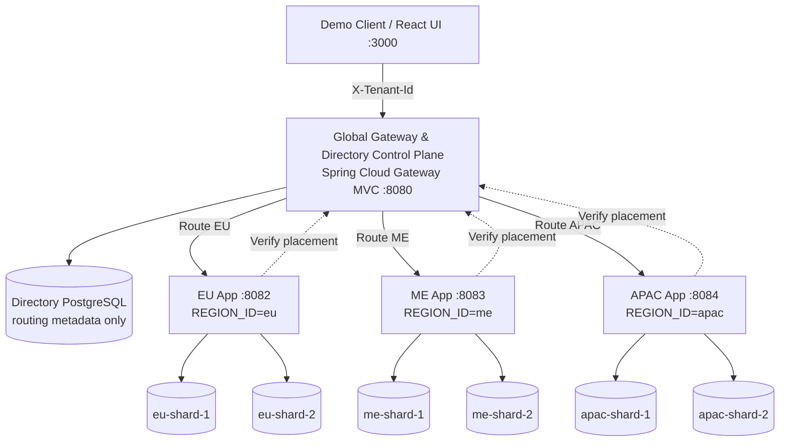

# Regional Multi-Tenant Blogging SaaS Demo

> **IMPORTANT DISCLAIMER**
> This repository is an educational architectural demonstration illustrating geographic placement, physical database shard routing, and logical tenant isolation using Spring Boot 3.4, Hibernate 6, and Docker Compose. It illustrates technical architectural controls but does **not** itself establish or certify legal or regulatory compliance (e.g., GDPR, data residency laws, or cross-border data transfer mandates).

---

## 1. Overview & Architecture

This project demonstrates a multi-tenant blogging SaaS architecture where every tenant has:
1. **A Home Region:** Which regional deployment (`eu`, `me`, or `apac`) is authorized to serve the tenant.
2. **A Database Shard within that Region:** Which physical PostgreSQL database shard (`shard-1` or `shard-2`) inside that region stores the tenant's data.
3. **Logical Tenant Isolation:** Rows within a shared shard table are scoped to the current tenant via Hibernate 6 `@TenantId` discriminator filtering.



### Key Architectural Separation

| Multi-Tenancy Concern | Mechanism | Responsibility |
| :--- | :--- | :--- |
| **Geographic Placement** | Gateway + Regional Ownership Check | Directs requests to the assigned region (`eu`, `me`, `apac`). Regional app independently verifies `placement.region == REGION_ID` to prevent cross-region leaks. |
| **Physical Shard Routing** | Spring `AbstractRoutingDataSource` | Dynamically selects the finite HikariCP connection pool for `shard-1` or `shard-2` based on `TenantRequestContext.shardId()`. |
| **Logical Tenant Isolation** | Hibernate 6 `@TenantId` Discriminator | Ensures that when multiple tenants share the same physical shard database, queries and mutations are filtered by `tenant_id`. |

---

## 2. Technology Stack

- **Java 17 / 21 LTS**
- **Spring Boot 3.4.3** (Spring MVC, Spring Data JPA, Spring Cloud Gateway Server MVC, Actuator)
- **Hibernate 6.6** (`@TenantId`, `CurrentTenantIdentifierResolver`)
- **PostgreSQL 16.6-alpine** (7 independent database instances with isolated Docker networks)
- **Flyway 10.20** (Automated migrations for control-plane and regional shards)
- **HikariCP** (Finite connection pools with pool-level metrics)
- **Caffeine Cache** (In-memory caching of directory placement records with fail-closed behavior)
- **React 16 + Redux Toolkit** (`blog-front`)

---

## 3. Seeded Tenants

The control plane (`directory-db`) is pre-seeded with 6 active demo tenants:

| Tenant ID | Region | Shard | Allowed Deployment |
| :--- | :--- | :--- | :--- |
| `tenant-eu-001` | `eu` | `shard-1` | EU App Service (`eu-shard-1`) |
| `tenant-eu-002` | `eu` | `shard-2` | EU App Service (`eu-shard-2`) |
| `tenant-me-001` | `me` | `shard-1` | ME App Service (`me-shard-1`) |
| `tenant-me-002` | `me` | `shard-2` | ME App Service (`me-shard-2`) |
| `tenant-apac-001` | `apac` | `shard-1` | APAC App Service (`apac-shard-1`) |
| `tenant-apac-002` | `apac` | `shard-2` | APAC App Service (`apac-shard-2`) |

---

## 4. Quickstart with Docker Compose

### Prerequisites
- Docker Engine 24+ and Docker Compose v2+
- Git, curl, bash

### 1. Start the Complete Stack
```bash
# 1. Start all 10 containers (gateway, 3 regional apps, 7 databases)
docker compose up -d --build

# 2. Check health status (all services report healthy)
docker compose ps
```

### 2. Seed Demo Data
```bash
bash scripts/seed-demo-data.sh
```

### 3. Run Automated Smoke Tests
```bash
bash scripts/smoke-test.sh
```

---

## 5. REST API Examples

All API requests pass through the Global Gateway (`http://localhost:8080`) with the `X-Tenant-Id` header.

### 1. Create a Post
```bash
curl -X POST http://localhost:8080/api/posts \
  -H "Content-Type: application/json" \
  -H "X-Tenant-Id: tenant-eu-001" \
  -d '{
    "title": "Scaling Regional Multi-Tenancy",
    "body": "Detailed architecture patterns for Spring Boot and PostgreSQL."
  }'
```

### 2. List Tenant Posts (Newest First)
```bash
curl -X GET http://localhost:8080/api/posts \
  -H "X-Tenant-Id: tenant-eu-001"
```

### 3. Read a Post by ID
```bash
curl -X GET http://localhost:8080/api/posts/{postId} \
  -H "X-Tenant-Id: tenant-eu-001"
```

### 4. Publish / Update a Post
```bash
curl -X PATCH http://localhost:8080/api/posts/{postId} \
  -H "Content-Type: application/json" \
  -H "X-Tenant-Id: tenant-eu-001" \
  -d '{
    "status": "PUBLISHED"
  }'
```

### 5. Delete a Post
```bash
curl -X DELETE http://localhost:8080/api/posts/{postId} \
  -H "X-Tenant-Id: tenant-eu-001"
```

### 6. Inspect Safe Routing Diagnostics
```bash
curl -X GET http://localhost:8080/internal/routing-info \
  -H "X-Tenant-Id: tenant-eu-001"
```
**Example Response:**
```json
{
  "tenantId": "tenant-eu-001",
  "region": "eu",
  "shardId": "shard-1",
  "databaseIdentifier": "eu-shard-1/blog"
}
```

---

## 6. Running the React Frontend

The React frontend (`blog-front`) provides an interactive UI to switch tenants and visually test cross-region and shard isolation.

```bash
cd blog-front
npm install
npm start
```
Visit `http://localhost:3000`. You can:
- Switch between EU, Middle East, and APAC tenants from the dropdown.
- Inspect live directory placement records and real-time `/internal/routing-info` diagnostics.
- Create, view, edit, publish, and delete blog posts for each tenant.

---

## 7. Security & Fail-Closed Behaviors

1. **Cross-Tenant Access on Same Shard:** If Tenant A attempts to access Tenant B's post on the exact same physical database shard, Hibernate `@TenantId` filtering ensures the query returns `404 Not Found` without disclosing Tenant B's data.
2. **Direct Cross-Region Violation:** If a request with `X-Tenant-Id: tenant-eu-001` is sent directly to the Middle East container (`http://localhost:8083`), the regional app independently queries placement, identifies the region mismatch, and fails closed with `403 Forbidden`.
3. **Suspended Tenant:** Inactive/suspended tenants fail closed with `403 Forbidden`.
4. **Unknown Shard or Tenant:** Unknown tenants return `404 Not Found`; unknown shard IDs fail closed (`500/fail-closed`).
5. **Shard Outage:** Stopping a shard container (`docker compose stop eu-shard-1`) results in `503 Service Unavailable` for `tenant-eu-001` without failing over to `shard-2` or another region.

---

## 8. Resetting Demo Environment

To wipe all demo data and container volumes:
```bash
docker compose down -v
```

---

## 9. Alternative: Running with Embedded H2 (Zero-Docker / Low-Resource Setup)

For resource-constrained environments (e.g. machines with limited RAM) or fast local iteration without Docker, the demo can be run using **Embedded H2** in PostgreSQL mode (`MODE=PostgreSQL`) instead of 7 dedicated PostgreSQL containers.

In this setup:
- **0 Docker database containers required.**
- The `gateway` service embeds its directory metadata database (`./data/directory`).
- Each regional `blog-service` embeds two physical shard databases (`./data/{region}-shard-1` and `./data/{region}-shard-2`).
- Spring `AbstractRoutingDataSource`, Flyway migrations, and Hibernate 6 `@TenantId` multi-tenancy work identically.

### Step 1: Enable H2 at Runtime in `pom.xml`
In `gateway/pom.xml` and `blog-service/pom.xml`, update the H2 dependency scope from `<scope>test</scope>` to `<scope>runtime</scope>` (or remove the `<scope>` tag):

```xml
<dependency>
    <groupId>com.h2database</groupId>
    <artifactId>h2</artifactId>
    <scope>runtime</scope>
</dependency>
```

Then rebuild the jars:
```bash
mvn clean package -DskipTests
```

### Step 2: Run Services with Embedded H2

#### A. Gateway (`gateway`)
Start `gateway` with an embedded H2 directory database:

```bash
java -jar gateway/target/gateway-1.0.0-SNAPSHOT.jar \
  --server.port=8080 \
  --spring.datasource.url="jdbc:h2:file:./data/directory;DB_CLOSE_DELAY=-1;MODE=PostgreSQL" \
  --spring.datasource.username=sa \
  --spring.datasource.password="" \
  --spring.datasource.driver-class-name=org.h2.Driver \
  --spring.jpa.properties.hibernate.dialect=org.hibernate.dialect.H2Dialect \
  --app.regional.eu-url=http://localhost:8082 \
  --app.regional.me-url=http://localhost:8083 \
  --app.regional.apac-url=http://localhost:8084
```

#### B. Regional Blog Services (`blog-service`)
Launch the regional deployments pointing each shard to separate embedded H2 database files:

**EU Regional App (`eu` on port 8082):**
```bash
java -jar blog-service/target/blog-service-1.0.0-SNAPSHOT.jar \
  --server.port=8082 \
  --app.regional.region-id=eu \
  --app.regional.directory-base-url=http://localhost:8080 \
  --app.regional.shard1.jdbc-url="jdbc:h2:file:./data/eu-shard-1;DB_CLOSE_DELAY=-1;MODE=PostgreSQL" \
  --app.regional.shard1.username=sa \
  --app.regional.shard1.password="" \
  --app.regional.shard2.jdbc-url="jdbc:h2:file:./data/eu-shard-2;DB_CLOSE_DELAY=-1;MODE=PostgreSQL" \
  --app.regional.shard2.username=sa \
  --app.regional.shard2.password="" \
  --spring.jpa.properties.hibernate.dialect=org.hibernate.dialect.H2Dialect
```

**Middle East Regional App (`me` on port 8083):**
```bash
java -jar blog-service/target/blog-service-1.0.0-SNAPSHOT.jar \
  --server.port=8083 \
  --app.regional.region-id=me \
  --app.regional.directory-base-url=http://localhost:8080 \
  --app.regional.shard1.jdbc-url="jdbc:h2:file:./data/me-shard-1;DB_CLOSE_DELAY=-1;MODE=PostgreSQL" \
  --app.regional.shard1.username=sa \
  --app.regional.shard1.password="" \
  --app.regional.shard2.jdbc-url="jdbc:h2:file:./data/me-shard-2;DB_CLOSE_DELAY=-1;MODE=PostgreSQL" \
  --app.regional.shard2.username=sa \
  --app.regional.shard2.password="" \
  --spring.jpa.properties.hibernate.dialect=org.hibernate.dialect.H2Dialect
```

**APAC Regional App (`apac` on port 8084):**
```bash
java -jar blog-service/target/blog-service-1.0.0-SNAPSHOT.jar \
  --server.port=8084 \
  --app.regional.region-id=apac \
  --app.regional.directory-base-url=http://localhost:8080 \
  --app.regional.shard1.jdbc-url="jdbc:h2:file:./data/apac-shard-1;DB_CLOSE_DELAY=-1;MODE=PostgreSQL" \
  --app.regional.shard1.username=sa \
  --app.regional.shard1.password="" \
  --app.regional.shard2.jdbc-url="jdbc:h2:file:./data/apac-shard-2;DB_CLOSE_DELAY=-1;MODE=PostgreSQL" \
  --app.regional.shard2.username=sa \
  --app.regional.shard2.password="" \
  --spring.jpa.properties.hibernate.dialect=org.hibernate.dialect.H2Dialect
```

### File-Based vs In-Memory
- **File-Based Persistence (Recommended for manual verification):**
  Using `jdbc:h2:file:./data/<dbname>;DB_CLOSE_DELAY=-1;MODE=PostgreSQL` persists demo data in the `./data/` folder across restarts. To reset data, simply delete the `./data/` directory.
- **In-Memory (Ephemeral / Zero Disk Footprint):**
  Replace `file:./data/<dbname>` with `mem:<dbname>` (e.g. `jdbc:h2:mem:eu-shard-1;DB_CLOSE_DELAY=-1;MODE=PostgreSQL`). Data resets automatically whenever the processes exit.

